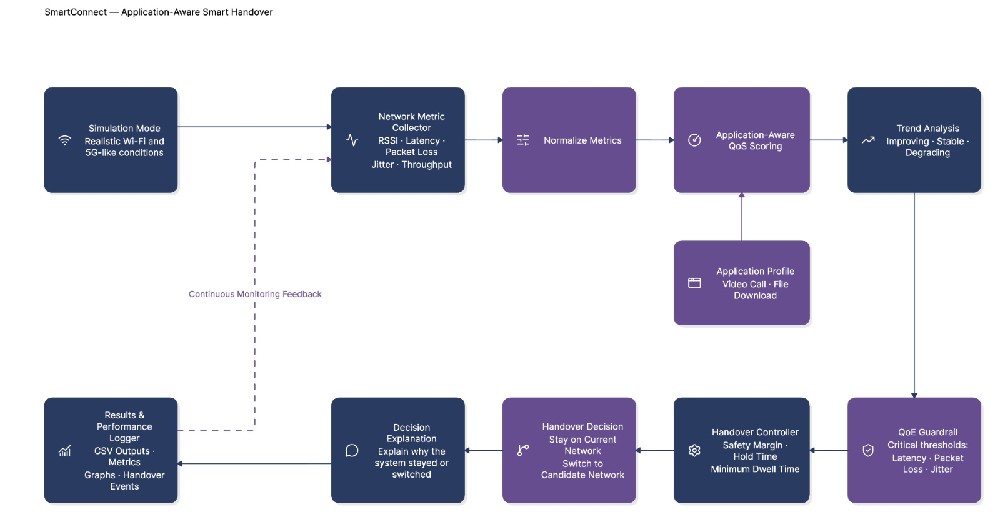
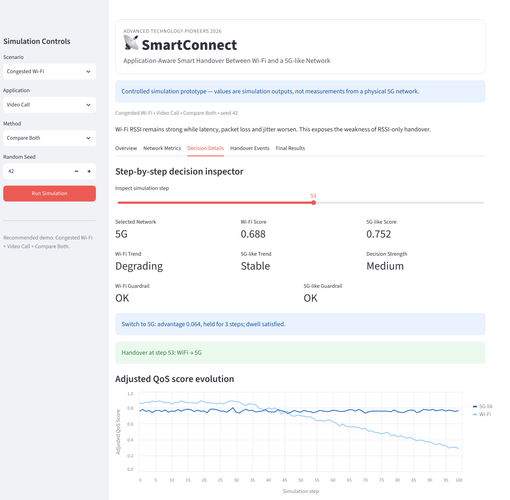
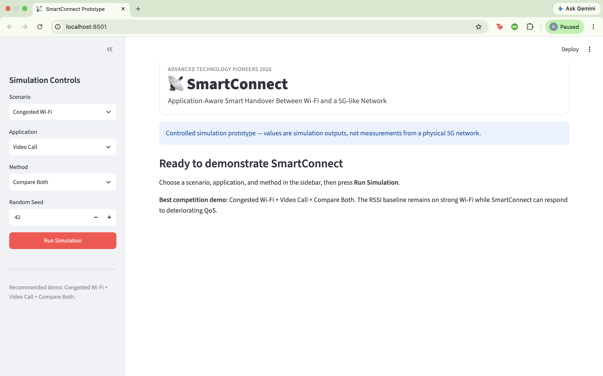
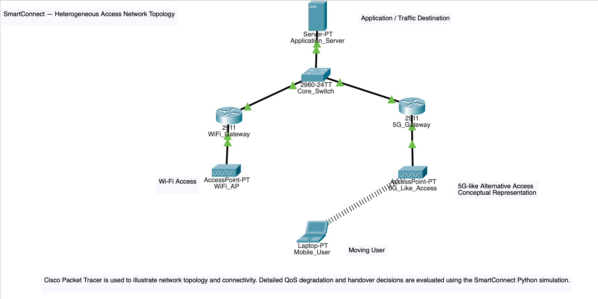
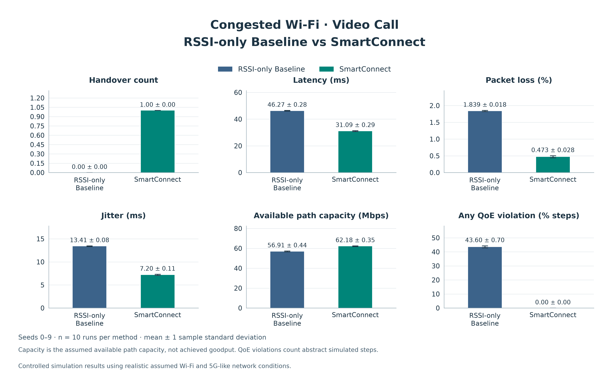
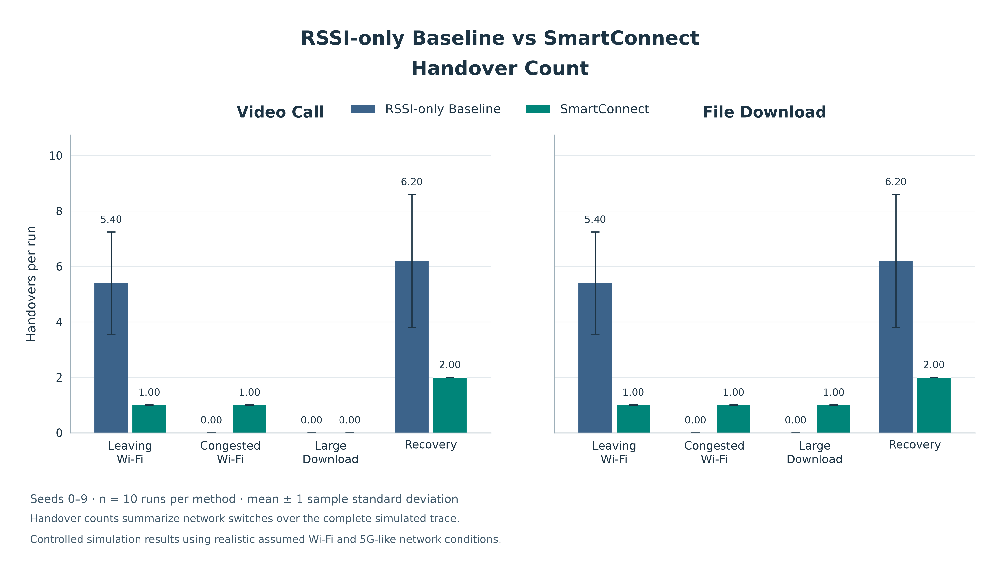
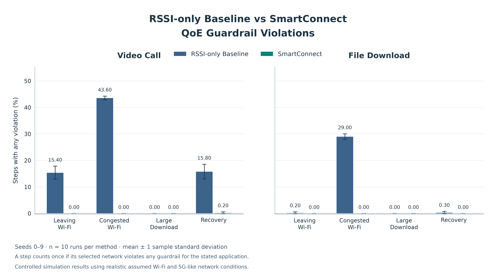

# SmartConnect

<p align="center">
  
</p>

**Application-aware smart handover between Wi-Fi and a 5G-like alternative access network.**

A working competition prototype that combines application priorities, network quality, and recent trends to explain when to stay connected and when to switch.

**Advanced Technology Pioneers 2026** · Python simulation · Streamlit demo · Reproducible evaluation

[Explore the prototype](#prototype) · [View the results](#key-results) · [Run locally](#installation) · [Meet the team](#team-contributions)

> **Simulation scope:** Network values are controlled, realistic simulation assumptions—not real-world field measurements. The banner is a concept illustration. This project does not implement a physical 5G network.

## What is SmartConnect?

SmartConnect is a deterministic, rule-based network-selection engine with an interactive demonstration and a completed repeated-seed evaluation. It compares Wi-Fi with a **5G-like alternative access network**, using RSSI, latency, packet loss, jitter, and throughput to make application-aware Quality of Service (QoS) decisions.

The repository brings together the scenario generator, an RSSI-only baseline, the SmartConnect engine, an explainable Streamlit prototype, a Cisco Packet Tracer topology, and the final experiment data.

## The problem: strong signal does not guarantee good service

The Strongest Signal First baseline selects the larger RSSI at every step: −50 dBm is stronger than −70 dBm. It chooses Wi-Fi on a tie and considers no other metric.

That rule misses congestion. A Wi-Fi signal can remain strong while latency, packet loss, and jitter deteriorate. It also misses application priorities: a video call values low delay and stable delivery, while a file download may benefit more from a higher-capacity path.

**Proposed solution:** Score both paths for the chosen application, account for recent quality trends, check application guardrails, and require sustained superiority before switching. Every decision includes an explanation.

## System architecture

<p align="center">
  
</p>

| Block | Role in the prototype |
| --- | --- |
| Simulation and metric collection | Supply both paths' five metrics at each simulation step. |
| Application profile and scoring | Apply the explicitly selected profile to normalized metrics. |
| Trend analysis and QoE guardrail | Track recent score direction and check prototype quality thresholds. |
| Handover controller | Apply the score margin, hold time, and minimum dwell time. |
| Decision and results logging | Record the selected path, handovers, scores, trends, and stay/switch reasons. |

The diagram represents the logical workflow. In Python, both paths are observed from a predefined trace; feedback means processing successive observations, not changing the trace or controlling physical network interfaces.

## How SmartConnect works

1. **Choose an application.** Select `video_call` or `file_download`; the prototype does not automatically detect applications.
2. **Read both paths.** Collect RSSI (dBm), latency (ms), packet loss (%), jitter (ms), and throughput (Mbps) from the current trace row.
3. **Normalize and score.** Fixed bounds map each metric to [0, 1], with higher always better. The application weights below produce a weighted QoS score.
4. **Adjust for trend.** Fit a line to up to the latest five QoS scores, including the current step. Add `0.5 × slope` and clamp to [0, 1]. The slope labels are Improving, Stable, or Degrading, with a ±0.002 deadband. This uses current/past observations only; it is not a trained prediction model.
5. **Check quality guardrails.** A candidate must pass the application's thresholds. If the current path breaches a guardrail, a passing candidate with a positive score advantage can qualify even below the normal margin.
6. **Control the handover.** Normally require an adjusted-score advantage of at least **0.05**, sustained for **3 consecutive steps**, and at least **8 steps since the last switch**. Guardrail rescue still respects hold and dwell time. SmartConnect starts on Wi-Fi.
7. **Explain the decision.** Record the selected network, scores, trends, guardrail status, handover event, and why the engine stayed or switched. “Decision Strength” is a heuristic label, not statistical confidence.

Exact bounds, thresholds, and defaults are defined in [smartconnect.py](smartconnect.py). All timing parameters use simulation steps, not seconds.

### Supported applications

| Profile | RSSI | Latency | Loss | Jitter | Throughput | Prototype guardrail breaches |
| --- | ---: | ---: | ---: | ---: | ---: | --- |
| **Video Call** | 10% | 30% | 30% | 20% | 10% | Latency >60 ms, loss >2%, or jitter >20 ms |
| **File Download** | 15% | 15% | 15% | 10% | 45% | Loss >3% or throughput <20 Mbps |

Weights sum to 100% per profile. Equality at a guardrail threshold is allowed. These thresholds are prototype assumptions, not validated service guarantees.

## Four scenarios

Each trace contains **100 steps** of deterministic scenario behavior plus small seeded Gaussian noise. The alternative path stays comparatively stable.

| Scenario | Network behavior | What it tests |
| --- | --- | --- |
| **Leaving Wi-Fi** · `leaving_wifi` | Wi-Fi RSSI weakens; latency, loss, and jitter rise; throughput falls. | When to leave a deteriorating connection. |
| **Congested Wi-Fi** · `congested_wifi` | Wi-Fi RSSI remains near −52 dBm while QoS progressively worsens after step 30. | Why signal strength alone misses service degradation. |
| **Large Download** · `large_download` | Both paths remain usable. Wi-Fi has stronger RSSI and generally lower latency; the alternative has substantially higher capacity. | Application-dependent quality/capacity trade-offs. |
| **Recovery** · `recovery` | Wi-Fi deteriorates as the user moves away, then improves as the user returns. | Stable switching and the timing of a return to Wi-Fi. |

## Prototype

The [Streamlit app](app.py) lets a judge select a scenario, application, method, and seed, then compare both algorithms on identical trace copies. Its tabs show an overview, network metrics, decision details, handover events, and the stored final evaluation summary.

**Recommended demonstration:** Congested Wi-Fi → Video Call → Compare Both → seed 42 → **Run Simulation**. The baseline stays on strong Wi-Fi; SmartConnect responds to deteriorating application-relevant QoS.

<p align="center">
  
</p>

*Single-run demonstration: the inspector exposes the scores, trends, guardrails, and reason for the switch. Its seed-42 values are separate from the final ten-seed statistics below.*

<details>
<summary>View the prototype start screen</summary>

<p align="center">
  
</p>

</details>

## Network topology

<p align="center">
  
</p>

[View the full-resolution topology](docs/images/smartconnect_topology.png) · [Cisco Packet Tracer topology file](cisco/SmartConnect_Topology.pkt)

Packet Tracer illustrates **network topology and connectivity**. The access point labeled as the 5G-like alternative is a conceptual representation, not a 5G radio/core implementation. The Python simulation evaluates QoS degradation and handover behavior; it does not drive this topology.

## Experimental evaluation

The finalized evaluation uses **four scenarios × ten seeds (0–9) × three configurations = 120 executions**, each containing 100 steps. The configurations are the RSSI baseline, SmartConnect/Video Call, and SmartConnect/File Download.

For each scenario and seed, all three configurations receive exactly the same 11 trace columns: time and both paths' five metrics. Each baseline run is reused for the two application comparisons, so every comparison still has **n = 10**, not 20.

Selected-path latency, loss, jitter, and capacity are averaged per run; handovers are counted per run. Per-run metrics are then summarized across seeds as **mean ± sample standard deviation**. Error bars show SD, not confidence intervals. Both methods are evaluated against the same application's guardrails; a step breaching multiple limits counts once in the combined violation rate. Initial attachment is excluded from handover counts.

The [analysis manifest](results/analysis_manifest.json) records the source revision, hashes, and design. The [stored independent audit](results/verification/independent_audit.json) reports matching traces for all 40 scenario/seed groups and verified summary statistics.

## Key results

**Congested Wi-Fi + Video Call** is the central demonstration: strong RSSI keeps the baseline on Wi-Fi even as service quality deteriorates. SmartConnect switches once per run in the finalized evaluation.

| Selected-path metric | RSSI baseline | SmartConnect |
| --- | ---: | ---: |
| Latency (ms) | 46.27 ± 0.28 | **31.09 ± 0.29** |
| Packet loss (%) | 1.839 ± 0.018 | **0.473 ± 0.028** |
| Jitter (ms) | 13.41 ± 0.08 | **7.20 ± 0.11** |
| Steps with any application guardrail breach (%) | 43.60 ± 0.70 | **0.00 ± 0.00** |
| Handovers per run | 0.00 ± 0.00 | 1.00 ± 0.00 |

**Large Download + File Download** shows a deliberate trade-off: higher available capacity comes with higher latency and one handover.

| Selected-path metric | RSSI baseline | SmartConnect |
| --- | ---: | ---: |
| Available capacity (Mbps) | 35.02 ± 0.44 | **69.18 ± 0.49** |
| Latency (ms) | **25.10 ± 0.23** | 37.75 ± 0.17 |
| Handovers per run | 0.00 ± 0.00 | 1.00 ± 0.00 |

For **Leaving Wi-Fi + Video Call**, handovers fall from **5.40 ± 1.84 to 1.00 ± 0.00**. For **Recovery + Video Call**, they fall from **6.20 ± 2.39 to 2.00 ± 0.00**, but the final return to Wi-Fi occurs later: step **69.30 ± 2.00 → 93.90 ± 1.20**. Fewer switches do not imply that every baseline switch was unnecessary.

All values above are across ten seeds. Sources: [mean and SD](results/tables/mean_sd.csv), [paired differences](results/tables/paired_differences.csv) (SmartConnect minus baseline), and [final findings](results/findings.txt). Zero observed guardrail breaches in this experiment is not a real-world service guarantee.

### Final result figures

These figures summarize the repeated-seed evaluation, not a single prototype run.

<p align="center">
  
</p>

<p align="center">
  
</p>

<p align="center">
  
</p>

[Browse all final figures](results/figures/)

## Repository structure

```text
smartconnect/
├── app.py                    # Interactive Streamlit prototype
├── smartconnect.py           # Application-aware decision engine
├── baseline.py               # Strongest Signal First comparison
├── scenarios.py              # Reproducible synthetic network traces
├── simulate.py               # CLI runner, CSV export, verification plots
├── config.py                 # Duration, default seed, scenario names
├── test_simulation.py        # Trace and baseline tests
├── test_smartconnect.py      # Engine and comparison tests
├── requirements.txt          # Pinned Python dependencies
├── analysis/                 # Experiment, analysis, plotting, audit scripts
├── results/                  # Finalized repeated-seed evaluation
│   ├── raw_csv/              # 120 preserved run outputs
│   ├── tables/               # Per-run statistics and paired comparisons
│   ├── figures/              # Final comparison figures
│   ├── verification/         # Stored test log and independent audit
│   ├── analysis_manifest.json
│   ├── final_summary.csv     # Summary loaded by the prototype
│   └── findings.txt
├── outputs/                  # Individual CLI-run CSVs
├── plots/                    # Simulated network-trace verification plots
├── docs/images/              # Banner, architecture, topology, screenshots
└── cisco/                    # Packet Tracer topology file
```

## Installation

The finalized repeated-seed analysis was recorded using **Python 3.14.8**, as documented in the [analysis manifest](results/analysis_manifest.json). Other development environments may differ; use the pinned dependencies in `requirements.txt`. On macOS, activate the existing project environment:

```sh
cd ~/smartconnect
source venv/bin/activate
python -m pip install -r requirements.txt
```

For a fresh checkout, clone this repository and create `venv` once if it does not already exist:

```sh
git clone https://github.com/Rauda111/smartconnect.git
cd smartconnect
python3 -m venv venv
source venv/bin/activate
python -m pip install -r requirements.txt
```

## How to run

Run the baseline for any scenario; the default seed is 42:

```sh
python simulate.py --scenario leaving_wifi
python simulate.py --scenario congested_wifi
python simulate.py --scenario large_download
python simulate.py --scenario recovery
```

Compare methods using the same scenario and seed:

```sh
python simulate.py --scenario congested_wifi --method baseline --seed 42
python simulate.py --scenario congested_wifi --method smartconnect --application video_call --seed 42
python simulate.py --scenario large_download --method smartconnect --application file_download --seed 42
```

The CLI accepts `--method baseline|smartconnect` and `--application video_call|file_download`; its defaults are `baseline` and `video_call`. Seeds must be nonnegative integers. `python simulate.py --help` lists the options. **Compare Both** is a Streamlit option, not a CLI method.

CSV files go to `outputs/<scenario>_seed<seed>_baseline.csv` or `outputs/<scenario>_seed<seed>_smartconnect_<application>.csv`. Five network-metric plots go to `plots/<scenario>_seed<seed>_<metric>.png`. Repeating a run overwrites its corresponding artifacts; these are separate from the finalized `results/` evidence.

A fixed scenario, seed, configuration, and dependency set reproduces the underlying trace. Both algorithms preserve their input. For programmatic comparisons, generate once with `generate_scenario()` and pass separate copies to `apply_baseline()` and `apply_smartconnect()`.

### Run the Streamlit prototype

```sh
python -m streamlit run app.py
```

Open the local URL printed by Streamlit, normally `http://localhost:8501`. Choose **Congested Wi-Fi / Video Call / Compare Both / seed 42** and press **Run Simulation**. The Final Results tab reads `results/final_summary.csv`; it does not regenerate the repeated-seed experiment.

### Run tests

```sh
python -m unittest -v
```

The nine tests cover trace reproducibility, scenario trends and bounds, RSSI selection, identical baseline/SmartConnect inputs, causal decisions, guardrails, and hold/dwell behavior.

The scripts in [analysis/](analysis/) preserve the finalized experiment workflow. The experiment runner requires a clean tracked checkout, a fresh result destination, and no conflicting native run CSVs. Some analysis/audit checks are tied to the recorded source revision and original experiment-package provenance; they are not a one-command rerun against arbitrary revisions. The checked-in tables and figures can be inspected directly without regenerating them.

## Team contributions

| Team member | Contribution |
| --- | --- |
| **Rauda Alsheaili** | Networking & Emulation / Simulation & Baseline |
| **Eiman Alhosani** | SmartConnect Decision Engine |
| **Aaesha Alahmed** | Testing & Data Analysis |
| **Omar Abu Qiyas** | Prototype Integration & Demo |

## Limitations and simulation disclaimer

- Conditions are fixed scenario curves with small independent Gaussian noise and sensible clamps, not field measurements or a calibrated radio model. Both paths are assumed observable at every step.
- The 5G-like alternative access network is conceptual. Its illustrative signal values are not a calibrated comparison of Wi-Fi RSSI with cellular RSRP.
- Throughput represents assumed available path capacity, not measured download goodput. Time is abstract simulation steps; handover delay, outage, and cost are not modeled.
- Application weights, normalization bounds, guardrails, and switching parameters are heuristic prototype assumptions. There is no machine learning or trained prediction model.
- Ten seeds measure sensitivity to the modeled noise. They do not establish real-world generalization, application-level user experience, or optimality across all networks.

## AI-use declaration

AI assistance was used to help implement and verify the initial simulation/baseline work and to prepare this README. The results reported here come from the repository's stored experiment tables. The team remains responsible for reviewing the implementation, evidence, and competition submission.
